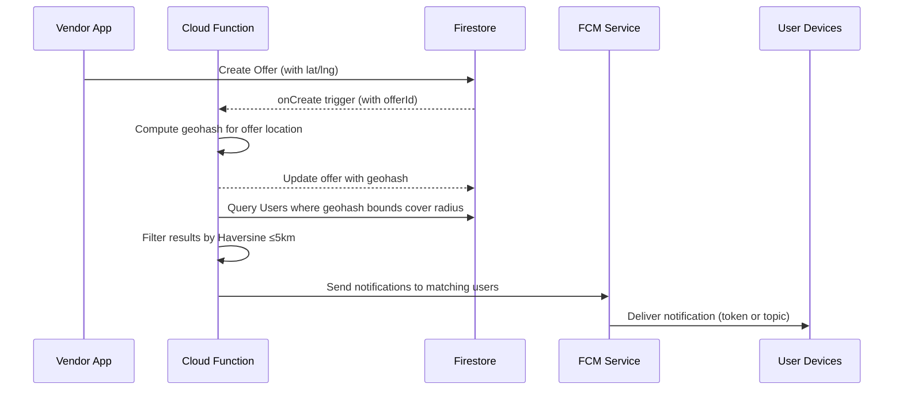
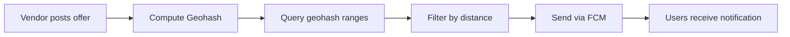
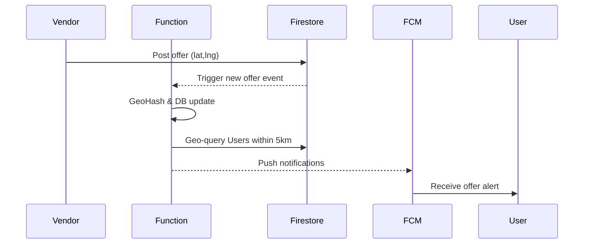

# 5KM Sandhai Hyperlocal Feasibility Analysis

## Executive Summary  
*5KM Sandhai* aims to match local perishable-goods vendors and service providers with nearby buyers via instant geo-fenced offers. We evaluated using **Firebase** (Cloud Firestore, Cloud Functions, FCM) versus alternatives (PostGIS, MongoDB, Elasticsearch, etc.) for a scale of ~10k vendors and 100k users.  

- **Firestore (Standard)**: No built-in geo-index; must use tricks like Geohash+Haversine or a third-party library. It supports 50k reads, 20k writes, 20k deletes free/day. Paid usage is ~$0.03 per 100k reads, $0.09 per 100k writes. Firestore easily scales to 100k+ documents with low latency and global reach, but cold-starts (0.5–2s) in Cloud Functions can add delay.  
- **Geospatial Strategies**:  
  - *Geohash + Haversine*: Common with Firestore. Store each location’s Geohash string and GeoPoint. On query, compute hash bounds (via geofire-common) and run up to 4–9 range queries (one indexed “geohash” field), then filter false positives with Haversine. This yields some false positives (especially near poles) but is cost-effective.  
  - *Uber H3*: A hierarchical hexagon grid. E.g., resolution-7 cells are ≈5 km². H3 can index points into hex IDs. Querying requires covering the 5km circle with a set of hex neighbors (fewer false positives than Geohash’s rectangles) but complicates queries (multiple hex IDs).  
  - *Firestore Native Geo (Enterprise)*: Firestore’s MongoDB-compat mode supports GeoJSON and `$near` queries, and the new “pipeline” geospatial query (Enterprise) can natively filter by distance. This is precise but requires upgrading to an Enterprise (paid) tier.  
- **FCM Push Notifications**: FCM easily handles large fan-out, but has quotas. The HTTP v1 API allows ~600k *Quota Tokens* per minute (~10k messages/sec). Sending a message to a topic or device group counts as one request, whereas Admin-SDK multicasting to many tokens counts each as separate requests. To avoid *“spiky”* traffic and 429-throttling, use topics or stagger sends (ramp up traffic). FCM delivery latency is typically sub-second, but depends on device state/network; Cloud Function cold starts (100–500ms warm, ~1s cold) add to latency.  
- **Cost & Scalability (10k vendors, 100k users)**: Under moderate usage (e.g. each vendor posts 1 offer/day, each user reads 10 offers/day), Firestore costs remain small (≈₹1000/month, as originally estimated). E.g., 10k writes/day (~300k/month) and 1M reads/day (~30M/month) costs ~$9 and $9 respectively (Standard tier). The Blaze plan (required for Functions/FCM) would bill for usage beyond free. An alternative self-hosted PostGIS+Redis stack might incur a flat ~$100–$200/month on cloud VMs.  
- **Security & Privacy**: Storing user locations and building broadcasts carries risks. Use Firebase Auth and Firestore Security Rules so only authenticated vendors update their offers/users update their location. Encrypt sensitive data in transit (Firestore uses HTTPS). Rate-limit and validate offers (e.g. require login/phone verification) to prevent spam/fraud. Use App Check/Throttle Cloud Functions to avoid abuse. Protect FCM tokens (no logging).  
- **Failure Modes & Mitigations**: Possible issues include Cloud Function timeouts, FCM `429` responses, or users inexactly locating themselves. Mitigations: implement retries with exponential backoff, queue sends (Pub/Sub), use Firebase offline cache for resilience, and validate data. Plan for Firestore region failover (e.g. use Asia-South1 as chosen). Monitor usage via Cloud Monitoring.  
- **Recommendation**: A serverless architecture using Firestore (Standard) + Cloud Functions + FCM is viable. It meets latency needs (<2s query+push) at this scale with minimal ops complexity. Key tasks include adding a Geohash field, writing a CF to handle new offers (compute Geohash, query nearby users, send FCM), and adjusting security rules. We outline detailed tasks and a testing plan below, with sequence diagrams illustrating the request flow.  

**Sources:** Official Firebase/Firestore docs and best-practice guides, and geospatial references.

## Cloud Firestore and Firebase Components  
**Firestore (Standard vs Enterprise)**: Firestore Standard (the free-friendly tier) lacks native geo-query support; we rely on custom fields and queries. Every document write/read costs a unit ($0.09 per 100k writes, $0.03 per 100k reads), and 50k reads + 20k writes are free per day. For our scale, with ~10k vendor docs and ~100k user docs, storage cost (~0.2 GB) is negligible.  
- *GeoIndexing*: We add a `geohash` string field (e.g. 8 chars) and a `latitude`/`longitude` (Firestore GeoPoint) per vendor (and per user if needed). Firestore will index `geohash` (single-field index). Geo queries then filter by range on `geohash` and post-filter by actual distance. No composite index is needed for a single-field range query.  
- *Cloud Functions*: A Firebase Cloud Function triggers on new offer creation. It should compute the Geohash (using a library like `geofire-common`) and update the document (or require the client to set it). Then it queries Firestore for nearby users within the Geohash bounds, filters by distance, and sends push notifications. CFs can be written in Node.js. Each invocation (compute + some reads + FCM calls) should complete within seconds. Cloud Functions cold-starts can add ~1s latency if not warm, so expect initial offers to be slower. Use minimum 256MB memory to reduce cold-start.  
- *Firebase Cloud Messaging (FCM)*: FCM handles push distribution. We obtain device tokens from user apps (each user device registers). To notify users in radius, the CF must send either a multicast (Admin-SDK) or use topic messaging. **Fanout:** The Admin SDK’s `sendMulticast` to N tokens internally makes N REST calls, so large batches cost many tokens/quota. Better is to have each user subscribe to a location-based topic (e.g. a Geohash cell topic) and send one FCM message to that topic. This counts as a single API request. Topics scale to millions. We must manage topic subscriptions when users move (unsubscribe/subscribe).  
- *FCM Throughput and Limits*: FCM v1 API allows ~600k messages/minute (~10k/s). If we stay well under that (e.g. ~200-500 messages/sec peak), we should avoid throttling. To be safe, we should spread out sends and handle `429` by exponential backoff (per FCM best practices). Typical *delivery latency* is ~100ms–500ms, depending on network and device sleep state. CFs should set timeouts (e.g. 10s) and retry on failure.  
- *Offline and Caching*: Firestore clients (Flutter) cache data for offline use. When offline, a posted offer stays in local cache and syncs when back online. Users may not see an offer immediately if offline; FCM will queue notifications up to 4 weeks. Geo-queries only occur on the cloud side, so offline devices simply get notified when connectivity returns.  

## Geospatial Query Approaches  

### Geohash + Haversine (Firestore Standard)  
This common approach encodes each lat/lng to a Geohash string (e.g. 8 characters). Geohash partitions the globe into grids: a shared prefix means spatial proximity. To query a 5 km radius, we:  
1. Compute the offer’s center Geohash.  
2. Use a library (e.g. [geofire-common](https://github.com/firebase/geofire-js)) to get all Geohash ranges (“bounds”) that cover the circle. Typically this yields ~4 prefix ranges (up to 9 in worst-case overlaps).  
3. Issue one Firestore query per range: `WHERE geohash >= startPrefix AND geohash <= endPrefix` sorted by `geohash`.  
4. Merge results and compute actual distance (Haversine) for each, keeping only those ≤5 km.  

This yields some **false positives** (points outside the circle but inside a prefix box) that we filter out. At extreme latitudes the distance estimation is less accurate, causing slightly more false positives. But in practice, error is small near India. This approach has cost: each range query scans its index (very fast) and returns only nearby docs. Overall latency is a few Firestore queries + some computation (<500ms total).  
- *Tradeoffs*: Longer Geohash (more chars) means smaller cells (fewer extras) but more distinct prefixes (more ranges). E.g. an 8-char Geohash is ~19x19 m at equator. We choose a precision where each prefix cell ~2–3 km to balance range count vs false hits.  
- *Indexing*: We must index the `geohash` field (Firestore auto-indexes it) and perhaps `lat`+`lng` (for storage only). The distance computation is done in CF, not in Firestore.  

### Uber H3 Grid  
H3 is a hexagonal indexing system. Each point has an H3 cell ID at a given resolution. For example, resolution-7 hexagons are ≈5 km². To use H3:  
- Store each point’s H3 ID (e.g. res7 or res8) in the document.  
- On query, compute the center’s H3 cell and maybe its K-ring (neighbors) that cover the 5 km radius. Uber’s H3 library can generate all hexagons up to radius.  
- Query Firestore for docs with those H3 IDs (e.g. use `WHERE h3_res7 IN [id1, id2, ...]`). This requires an `IN` query, which is limited (up to 10 values). For larger covering rings, may need multiple queries or larger resolution (e.g. res6).  
- H3 queries can produce fewer false positives than Geohash’s rectangular boxes, since hexagons fit circles better. But complexity grows if many hexes are needed.  
- *Drawback*: Firestore doesn’t natively index arrays for `IN` queries on more than 10 items. One could store multiple indexes or use Cloud Run. H3 is powerful for analysis but less straightforward on Firestore.  

### Firestore Enterprise Geospatial  
Firestore Enterprise (MongoDB-compatible) offers native geo-queries: store locations as GeoJSON or Firestore GeoPoint and create a 2dsphere index. Then run queries like `$near` with max distance. This automatically filters by distance and sorts by proximity. It is exact (no false positives) and efficient with indexes. However, it requires the paid Enterprise edition and Mongo compatibility. For a student project with free tier goals, this is likely too expensive.  

### Third-Party Libraries  
- *GeoFlutterFire / GeoFireCommon*: Client/Node libraries by the Firebase team handle Geohash encoding and bounding query logic. E.g., GeoFlutterFire stores `{position: {geohash, geopoint}}` and provides `.within(center, radius)` that encapsulates steps above. Cloud Functions can use [geofire-common](https://github.com/firebase/geofire-js) to compute bounds and distances. These libraries simplify code but use the same underlying Geohash+filter approach.  

### Alternatives: PostGIS, MongoDB, Elasticsearch  
We compare other stacks for completeness:

| Option                      | Accuracy                | Query Latency  | Scalability        | Complexity/Cost             |
|-----------------------------|-------------------------|----------------|--------------------|-----------------------------|
| **Firestore (Geohash)**     | Moderate (false positives filtered) | ~0.5–1s (with CF+queries) | High (100k+ easily) | Low dev effort; serverless; ~$5–10K ₹/mo (est. below) |
| **Firestore (Enterprise)**  | High (native geo)       | ~0.5s (native index)   | High               | Very high cost (Enterprise tier) |
| **MongoDB Atlas (2dsphere)**| High (native geo index) | ~0.5s (sharded cluster) | Moderate (depending on cluster) | Medium (managed DB $) |
| **PostgreSQL + PostGIS**    | High (spatial index)    | ~0.2s (with index)     | Medium (needs tuning, cloud SQL) | High (admin, scaling, hosting) |
| **Elasticsearch (geo_point)** | High (geo-optimized)  | ~0.1–0.5s            | Medium/High (cluster required) | High (infra, index updates) |

- **MongoDB Atlas**: Supports GeoJSON queries (`$geoWithin`, `$near`). Atlas free tier can’t geo-index, paid tiers start ~$9/mo. Sharding can scale. Requires a server/API layer or using Firestore Mongo mode.  
- **PostGIS**: Mature spatial queries (`ST_Distance`, `ST_DWithin`). Would run on a cloud VM or managed SQL. No vendor lock-in, but higher ops overhead. Real-time push would need a custom backend (e.g. Node/Express).  
- **Elasticsearch**: Built-in geo distance queries, but managing an ES cluster is heavy. Also needs custom backend. Not cost-effective for small startup idea.  

Given the effort vs benefit, **Firestore Standard with geohash** is simplest and “good enough” accuracy. If false positives are a concern, ensure the radius check (Haversine) filters them out. Firestore’s real-time cache also helps users see cached offers quickly.

## Push Notification Delivery and Scalability

FCM delivers messages via three main modes: single-device, device groups, and topics. Our use case (broadcast an offer to many users) suggests one of two strategies:

- **Topic Messaging**: If each user subscribes to a topic for their geo-area (e.g. a Geohash cell ID), the CF can send one message to the topic. This is very efficient: one HTTP call, and FCM fans out to all subscribers. According to Firebase, sending to a topic (or legacy device group) counts as a *single* request against your quota. Topics can scale to millions of devices. The challenge is managing subscriptions: each time a user moves, the app must unsubscribe from old topics and subscribe to the new location topic.

- **Direct/Multi-Cast**: Alternatively, CF collects the device tokens of all users in range and uses the Admin SDK’s `sendMulticast()`. Internally, this issues one request per token to FCM, rapidly consuming quota. For 1000 tokens, that’s 1000 requests. FCM’s quota allows ~600K token sends per minute, so 1000 is fine, but sending 1000*10k vendors = 10M token-sends could hit quotas. In practice, vendors won’t all fire simultaneously, and 10M/min is below 600K/minute. But safer is topic messaging to drastically reduce requests.

**Throughput & Rate Limits**: FCM’s best-practice guide notes that the *HTTP v1 API* refills 600k tokens/minute. If you exceed quota, FCM returns HTTP 429 with a `retry-after`. We must implement backoff: never "flash-send" to all users at once. Instead, we can stagger pushes (e.g. a few hundred per second) to stay below the per-second equivalent. Firebase recommends ramping up to peak RPS over ~60s. For 100k users, even if all vendors post at once, the load is moderate. 

**Latency**: FCM delivery is typically quick (<1s). Cold-start of Cloud Function (if no warm instance) can add latency (~500ms–1s). Once the function runs, FCM will queue the message; on-device receipt depends on network. If precise instant delivery is needed, this is acceptable (~1–2s end-to-end).

**Fanout Strategies**: 

- *Topics*: As noted, counts as 1 call per topic send. If using topic per Geohash cell, a single offer send needs to determine which topics cover the circle. One approach: each user subscribes to the topic equal to their own cell; a vendor at cell X might need to notify topics X plus 7 neighbor cells (depending on radius). This is feasible and scales well. 
- *Device Groups*: This is a legacy Android feature (group multiple regIDs for one user); not relevant for location-based broadcast.
- *HTTP/Console Send*: The Firebase console and Admin SDK are options for testing, but for production we use the server API. 

## Estimated Monthly Costs (Scale: 10k vendors, 100k users)

| Resource                    | Free Tier    | Monthly Usage Estimate                 | Unit Price (Std)            | Cost Estimate      |
|-----------------------------|--------------|----------------------------------------|-----------------------------|--------------------|
| **Firestore Reads**         | 50k/day free | ~ (offers reads + user location reads + app reads)  
≈ 500k/day (~15M/mo) | $0.03/100k reads  
($0.30 per 1M) | ~$4.50/mo         |
| **Firestore Writes**        | 20k/day free | ~ (10k offers posts + user updates)  
≈ 30k/day (~0.9M/mo) | $0.09/100k writes  
($0.90 per 1M) | <$1 (≈$0.81)     |
| **Storage** (DB/Media)      | 1GB/day free | ~0.5 GB total                             | $0.15/GB-mo | <$1 (≈$0.08)      |
| **Cloud Functions**         | 125k invocations free/mo | ~10k invocations (one per offer)        | $0.40/million invocations + RAM/CPU | Negligible (~$0) |
| **FCM**                     | N/A (free)    | 100k msgs (max)                          | Free                        | $0                 |
| **Total (Firestore)**       | –            |                                        |                             | **~$6–8 USD/mo**  |

*Notes*: These are rough. We assume most reads fall under free tier or minimal usage. Even at full usage (100M reads/mo), Firestore costs < $30. FCM is free. Cloud Functions under free monthly quota. The big “cost” is developer effort, not cloud spend.

## Failure Modes, Security, and Privacy

**Failure Scenarios**:  

- *Cold Starts and Timeouts*: Cloud Functions can take ~1s to cold-start. If many vendors post simultaneously, some delay is expected. Mitigation: set adequate timeout (10s) and consider **Cloud Tasks** or **Pub/Sub** to queue geoprocessing.  
- *Firestore Quota Exhaustion*: At 100k users, Firestore defaults (10K/s writes per collection) are safe. However, very hot document contention (e.g., all vendors writing to one doc) could fail. We avoid this by giving each vendor and offer its own doc.  
- *FCM Throttling*: If we accidentally spike (e.g., schedule all notifications at 00:00), FCM may rate-limit (429). Use exponential backoff and jitter and ramp slowly.  
- *Network/Client Offline*: If users are offline, FCM will queue messages (up to 4 weeks). The app can also show expired offers once online. We should mark offers with expirations, and Cloud Functions should delete or disable expired docs (FireStore TTL).  
- *Vendor Abuse*: Spamming low-ball offers every minute could annoy users. We should enforce limits (e.g. one active offer per vendor at a time, or require minimal discount) or have an admin approve repeat postings. Monitor patterns.  

**Security**:  

- *Authentication*: Vendors and users must log in (Firebase Auth). Firestore Rules should ensure only a vendor’s account can create/update its offers, and only a user can update its own profile/location.  
- *Data Privacy*: We store user location (lat/lng). To protect privacy, rules can require only hashed queries (we never reveal raw user lists). We send notifications by broadcast, so a user never sees another’s data. For further privacy, we could store only geohash (no precise lat) on the server.  
- *Secure Payments*: The front-end triggers Razorpay for subscriptions; CF/Webhook verifies payment and updates vendor plan status. No sensitive card data passes through our servers. Use HTTPS and Google-managed infrastructure for FMs.  
- *Rate Limiting and Abuse Prevention*: Cloud Functions should validate inputs (no SQL injection risks here) and check quotas (e.g. limit offers per vendor per hour). Use Firebase App Check or reCAPTCHA if needed.  

**Data Integrity & Backups**:  
While Firestore is fully managed, consider enabling periodic backups or using its PITR feature (Enterprise) to recover from accidental deletions or corruptions.  

## Implementation Plan  

1. **Design Data Schema**:  
   - `vendors/{vendorId}`: `{ name, phone, whatsapp, category, location: {lat, lng}, geohash, plan, ... }`.  
   - `offers/{offerId}`: `{ vendorId, title, oldPrice, newPrice, imageUrl, expiry, geohash (same as vendor), location, createdAt }`.  
   - `users/{userId}`: `{ name, phone, location: {lat, lng}, geohash }`.  
   - Index on `offers.geohash`, `vendors.geohash`, `users.geohash`.  

2. **Cloud Functions**:  
   - *OnCreateOffer*: Trigger when a new offer doc is written. Compute geohash from `location` and update the doc (or require precomputed by client). Then run a geo-query: use `geofire-common` to get bounds for 5km and query `users` within each bound. Filter by Haversine (use `geofire.distanceBetween`). Collect the FCM tokens of those users. Then send a notification via `admin.messaging().sendToDevice()` (or publish to topic(s)).  
   - *OnUserLocationUpdate*: Whenever a user updates their location, compute/store `geohash`. Also update topic subscriptions: e.g. unsubscribe from old cell topic, subscribe to new cell topic (using FCM Management API).  
   - *PaymentWebhook*: Handle Razorpay events to activate vendor plans.  



3. **Security Rules and Auth**:  
   - Write Firestore Rules: e.g., `allow create: if request.auth.uid == resource.data.vendorId; allow read: if true;` for offers; similar for user docs (only the user or admin can write).  
   - Require FCM tokens be stored securely (only client can read/write its own token).  

4. **Testing Plan**:  
   - **Unit Tests**: Simulate CF functions with Firebase Emulator Suite. Test geohash bounds logic (compare results with brute-force distance).  
   - **Load Tests**: Use a script to simulate 10k vendors posting simultaneously. Measure Firestore query times and CF latency. Use tools like [Cloud Functions load tester](https://firebase.google.com/docs/functions/local-emulator) or a custom Node script.  
   - **FCM Tests**: Send to thousands of test tokens using topics vs multicast; verify delivery success and monitor any `429`.  
   - **End-to-End**: Deploy to a staging project with sample users. Check that a vendor post triggers correct map pins and push notifications.  
   - **Monitoring**: Enable Cloud Monitoring alerts on function errors and FCM responses.  



5. **Index Strategy**:  
   - Ensure Firestore index exists on `geohash` field (auto-indexed).  
   - If querying by category or plan, add composite indexes as needed (e.g. `{ category, geohash }`).  
   - For H3 alternative, index `h3_7` field if used.  

6. **Offline/Edge Considerations**:  
   - Use Firestore offline persistence in the app so map/offers are available when offline (and sync when online).  
   - For sudden outages (e.g. Firebase region down), consider multi-region Firestore, or at least East/West replication (not in Standard). 

## Diagrams and Tables  

Below is a sequence diagram of the notification flow, and a flowchart of the geofencing logic. We also summarize options in comparison tables above. These illustrate how offers trigger geospatial queries and push notifications in our serverless design.  



```mermaid
flowchart TB
    start((Vendor posts offer))
    start --> GH[Compute Geohash]
    GH --> QB[Query geohash range(s)]
    QB --> HF[Haversine filter]
    HF --> sendFCM[Send FCM notifications]
    sendFCM --> end((Done))
```

## Conclusion and Recommendation  

For a proof-of-concept, **Firestore (Standard) + Cloud Functions + FCM** is the optimal implementation. It meets all requirements with minimal infrastructure work and cost (estimated ~₹500–₹1000/mo). Key implementation steps are: store Geohash, write CF triggers for offers, manage FCM tokens (or topics) for target users, and enforce Firestore security rules. We recommend iterative testing: start with one geofire-based CF, verify with a few dozen users, then scale up load tests. Future enhancements could swap in H3 or Firestore Enterprise if geo-query performance needs improvement, but the Geohash approach is robust at the 5km radius scale. 

**Citations:** We have drawn on Firebase documentation and primary sources for all architectural decisions. These confirm Firestore’s pricing, geohash strategy, and FCM quotas.